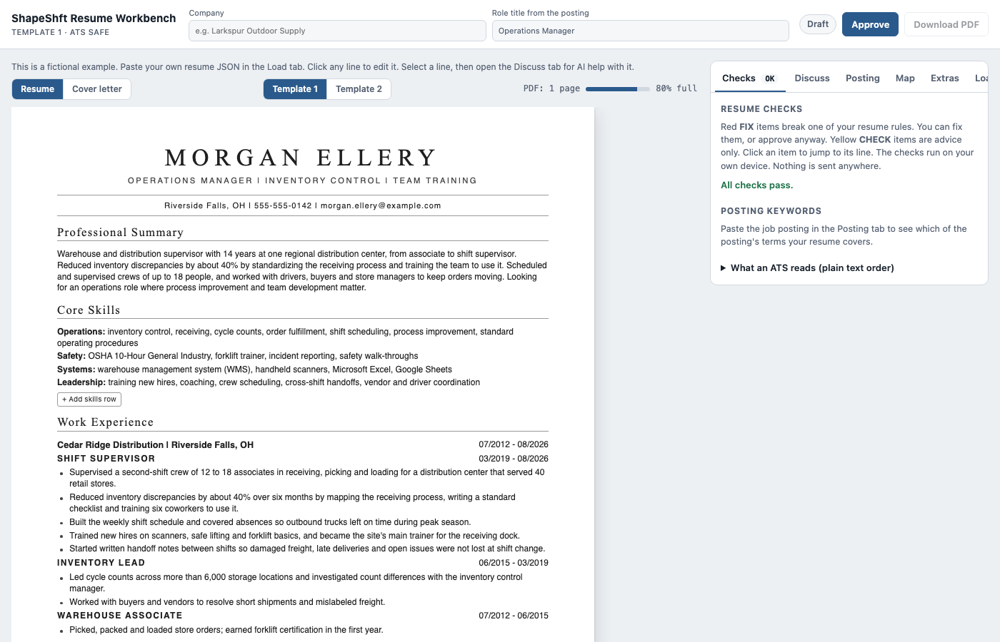
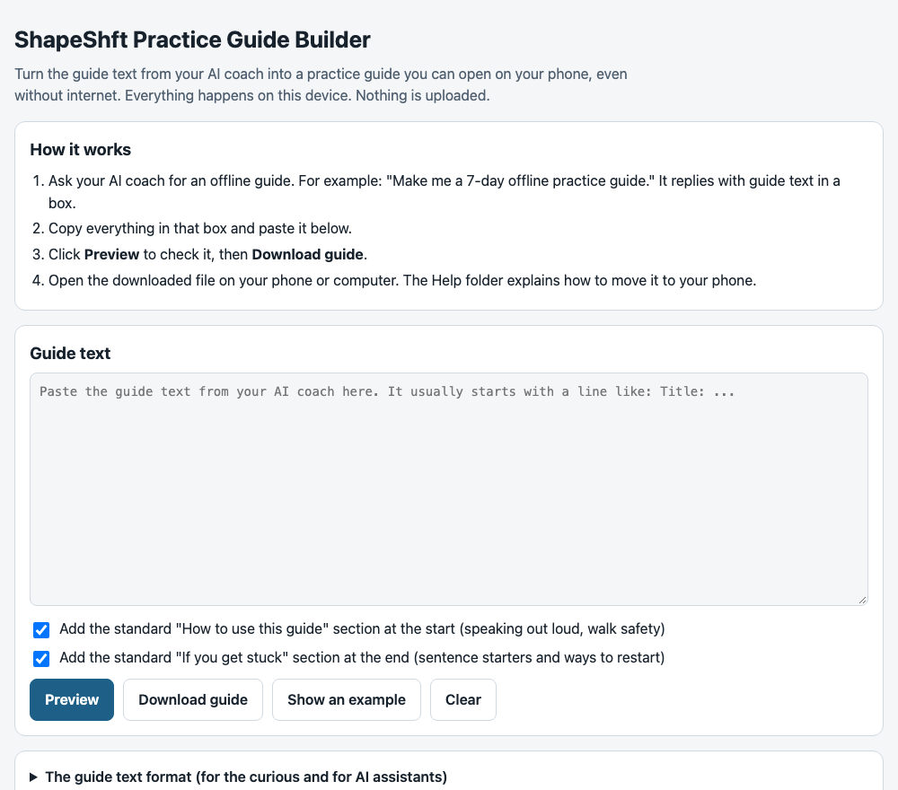

# START HERE: ShapeShft

ShapeShft is a free toolkit that helps you:

- write down your work experience, including things you may not think are important
- make truthful resumes and cover letters for specific jobs
- practice talking out loud about your work, so you can speak about it naturally
- prepare for interviews, and decide which jobs are right for you

You use it with your own AI assistant, such as Claude or ChatGPT. ShapeShft itself has no account, no fees and no tracking.

This guide takes you from download to your first useful result. You do not need any technical experience.

## Contents

**Part 1: One-time setup (about 20 minutes)**

1. [What you can use](#1-what-you-can-use)
2. [Download and unzip ShapeShft](#2-download-and-unzip-shapeshft)
3. [What is in the folder](#3-what-is-in-the-folder)
4. [Set up your AI assistant](#4-set-up-your-ai-assistant)

**Part 2: Getting started (first session)**

5. [Start Career Discovery](#5-start-career-discovery)
6. [Save your files](#6-save-your-files)

**Part 3: Things you will do again and again**

7. [Make an application](#7-make-an-application)
8. [Edit and download it in the Resume Workbench](#8-edit-and-download-it-in-the-resume-workbench)
9. [Start Conversation Coaching](#9-start-conversation-coaching)
10. [Do your first spoken practice](#10-do-your-first-spoken-practice)
11. [Make an offline practice guide](#11-make-an-offline-practice-guide)
12. [Prepare for an interview](#12-prepare-for-an-interview)
13. [Keep your Practice Journal up to date](#13-keep-your-practice-journal-up-to-date)
14. [Keep going on your own](#14-keep-going-on-your-own)

If something goes wrong at any step, see [Troubleshooting](docs/user/troubleshooting.md). You can also ask your AI assistant to guide you: copy Starter Prompt 1 from the `4-Prompts` folder.

---

# Part 1: One-time setup

## 1. What you can use

ShapeShft has two parts. Use either one, or both.

| Resume Builder | Conversation Coach |
|---|---|
| Records your experience in a Career Profile | Daily spoken practice about your work |
| Checks job postings against what matters to you | Practice based on real jobs |
| Writes tailored resumes and cover letters | Interview preparation for each interviewer |
| Lets you edit and download them as PDFs | Questions to ask employers, and reflection afterward |
| | Practice guides you can use offline, for example on a walk |

Both parts share your career files, so you never need to tell your story twice.

**What it costs:** ShapeShft is free. The AI assistant has free plans that are enough to start. Paid plans give you more messages per day, but they are optional. Details: [Choosing an AI assistant](docs/user/choosing-an-ai-assistant.md).

## 2. Download and unzip ShapeShft

You may have already done this if you are reading this file.

1. **Where:** on the ShapeShft page on GitHub, find **Releases** and click the newest version.
2. **What to click:** under **Assets**, click the file named like `ShapeShft-1.0.0.zip`. Do not choose "Source code".
3. **Unzip it:**
   - Windows: right-click the file, choose **Extract All**, then **Extract**.
   - Mac: double-click the file.
   - Phone: open the Files app and tap the file.
4. **What you should see:** a folder named `ShapeShft-1.0.0` with this guide inside it.

**If it goes wrong:** see "I cannot open the downloaded files" in [Troubleshooting](docs/user/troubleshooting.md#i-cannot-open-the-downloaded-files).

Keep this folder somewhere you can find it, such as Documents.

## 3. What is in the folder

| Folder | What it is | Do you need it? |
|---|---|---|
| `1-AI-Setup` | Instructions for your AI assistant | Yes, once, during setup |
| `2-Tools` | The Resume Workbench and the Practice Guide Builder. Open them in a web browser | Yes |
| `3-My-Files` | Your own career files. They start almost empty | Yes. This is your information |
| `4-Prompts` | Ready-made messages to copy into your AI assistant | Yes, often |
| `5-Examples` | Fictional examples of finished files, resumes and guides | Optional, helpful |
| `Help` | Setup guides, troubleshooting and privacy | When you need it |

You can ignore `1-AI-Setup/Claude-Skills` (optional, for Claude users who want it), `LICENSE.txt` and `THIRD-PARTY-NOTICES.txt` (legal information).

## 4. Set up your AI assistant

You will create a **project**: a workspace in your AI app that remembers the ShapeShft instructions and your files, so every chat starts ready.

1. **Create an account** with Claude (claude.ai) or ChatGPT (chatgpt.com) if you do not have one. The free plan is fine.
2. **Create a project** named `ShapeShft`. Projects are usually in the sidebar or menu.
3. **Add the instructions:** copy all the text from `1-AI-Setup/Project-Instructions.txt` into the project's instructions box.
4. **Add the instructions file:** add `1-AI-Setup/ShapeShft-AI-Instructions.md` to the project's files.
5. **Check it:** start a new chat in the project and type `ShapeShft check`. The assistant should say it can see the ShapeShft instructions.

Step-by-step guides with more detail: [Setting up Claude](docs/user/setup-claude.md) and [Setting up ChatGPT](docs/user/setup-chatgpt.md).

**If you cannot find projects,** or prefer not to use them: attach `ShapeShft-AI-Instructions.md` to any new chat and say "Please follow these ShapeShft instructions."

**Want the assistant to walk you through it?** Paste the text of `Project-Instructions.txt` into a normal chat, then copy Starter Prompt 1 from `4-Prompts/Starter-Prompts.md`.

Setup is done. You do not need to repeat it.

---

# Part 2: Getting started

## 5. Start Career Discovery

Career Discovery is a conversation with your AI assistant about your work. It builds your **Career Profile**, the record of your experience that everything else uses.

1. In a new chat in your ShapeShft project, copy **Starter Prompt 2** from `4-Prompts/Starter-Prompts.md`.
2. If you have an old resume or your LinkedIn profile text, add it. If not, that is fine.
3. Answer the questions. The assistant asks a few at a time.

**What to expect:** questions about your jobs, what you did on a normal day, problems you solved, people you helped or trained, and what matters to you in a job. It will not invent anything. It asks when it is unsure.

You do not need to document your whole career at once. After a short session, the assistant tells you when you have enough to make a first application or start practicing.

**If the assistant writes something that is not true:** correct it. You are the authority on your experience.

## 6. Save your files

At the end of a session, ask: "Please give me my updated ShapeShft files."

1. The assistant gives you each file (`career-profile.md`, and later `job-library.md` and `practice-journal.md`), either as a download or as text in a box.
2. Save each one in your `3-My-Files` folder, replacing the old file. For text in a box: open the file in a text editor, select all, paste, save.
3. Add the new files to your AI project, replacing old copies.

Keep a backup of `3-My-Files` somewhere safe. Details: [Your files, backups and updates](docs/user/your-files-and-backups.md).

---

# Part 3: Things you will do again and again

## 7. Make an application

1. Find a job posting. Copy the **whole** posting, from the title to the end.
2. In your ShapeShft project, use **Starter Prompt 4** and paste the posting.
3. The assistant:
   - tells you briefly if anything in the posting conflicts with what matters to you (it never stops you from applying)
   - asks a few questions about experience the posting mentions
   - writes a tailored resume and cover letter, and reviews them like a recruiter
   - gives you a short note and a block of **JSON** (computer-readable text that starts with `{`)
4. Copy the whole JSON block. Many apps have a copy button at the top of the box.

## 8. Edit and download it in the Resume Workbench

1. Open `2-Tools/ShapeShft-Resume-Workbench.html` in your web browser (double-click it).
2. Click the **Load** tab on the right. Paste the JSON. Click **Load resume**.
3. Read the **Checks** tab. Click any line on the sheet to edit it.
4. Click **Cover letter** above the sheet to see and edit the letter.
5. Click **Approve**, then **Download**. The PDF goes to your Downloads folder.
6. Read every line before you send it. You are responsible for what you send.

**If the Workbench will not load the JSON:** use Starter Prompt 6. More help: [Using the Resume Workbench](docs/user/using-the-workbench.md).

## 9. Start Conversation Coaching

The Conversation Coach helps you get comfortable talking about your work in your own words. **The practice is talking out loud to yourself.** Reading or thinking about answers is not enough. Saying them is what builds the skill.

Use **Starter Prompt 7**. The coach explains how practice works, asks a few questions, and gives you a short first session.

How it works, in more detail: [How Conversation Coach practice works](docs/user/how-practice-works.md).

## 10. Do your first spoken practice

1. Use **Starter Prompt 8** (today's practice) or **9** (practice for a specific job).
2. Read the first prompt, then **start talking out loud**. It is fine to stumble, pause, repeat yourself and wander.
3. If you get stuck, say one of the sentence starters and keep going.
4. If you like, practice on an easy walk somewhere familiar. Keep the session open on your phone, and **stop somewhere safe before you read**.
5. Afterward, come back to the chat and tell the coach what was easy, where you got stuck, and anything you remembered.

The coach does not hear you unless you share a recording or transcript. Talking privately to yourself is the whole method.

## 11. Make an offline practice guide

An offline guide is a practice document you can open on your phone without internet.

1. Use **Starter Prompt 10** (a 7-day guide). The coach replies with guide text in a box.
2. Copy the text.
3. Open `2-Tools/ShapeShft-Practice-Guide-Builder.html` in your web browser.
4. Paste the text, click **Preview**, then **Download guide**.
5. Move the file to your phone (email it to yourself, or use your cloud storage) and open it.

More help, including opening guides on iPhone and Android: [Offline practice guides](docs/user/practice-guides.md).

## 12. Prepare for an interview

Use **Starter Prompt 11**. Include who you are meeting, their job title, and any other interview stages you know about. The coach prepares you stage by stage and person by person, with:

- experiences worth talking through out loud
- honest ways to talk about gaps or concerns
- **questions to ask** them, so you can judge whether the job is right for you (Starter Prompt 12)

After the interview, use **Starter Prompt 13** to reflect while it is fresh. You can compare jobs with **Starter Prompt 14**.

## 13. Keep your Practice Journal up to date

Your Practice Journal keeps track of what you practiced, what was easy or hard, and what to practice next. After a session, use **Starter Prompt 15** and save the updated `practice-journal.md`. The coach uses it to plan your next session.

## 14. Keep going on your own

- **Each time:** start a chat in your ShapeShft project, and use a starter prompt.
- **When files change:** save them in `3-My-Files` and update the project.
- **When a chat gets long or you hit a usage limit:** use Starter Prompt 16, then continue in a new chat.
- **When ShapeShft updates:** see [Your files, backups and updates](docs/user/your-files-and-backups.md#updating-shapeshft).

The Conversation Coach is meant to make you need it less over time. The skills you build, recalling your experience and talking about it clearly, stay with you after your job search, for performance reviews, raises, networking and promotions.

---

**Important to know**

- ShapeShft helps you present your real experience. It never invents qualifications, and you should never send anything that is not true.
- No tool can promise an interview, a job, a salary, or that a resume will pass an employer's applicant tracking system.
- AI assistants make mistakes. Check everything.
- Read [Privacy](docs/user/privacy.md) before sharing personal information. Never share passwords, ID numbers or bank details.

ShapeShft is free and open source under the MIT License.
