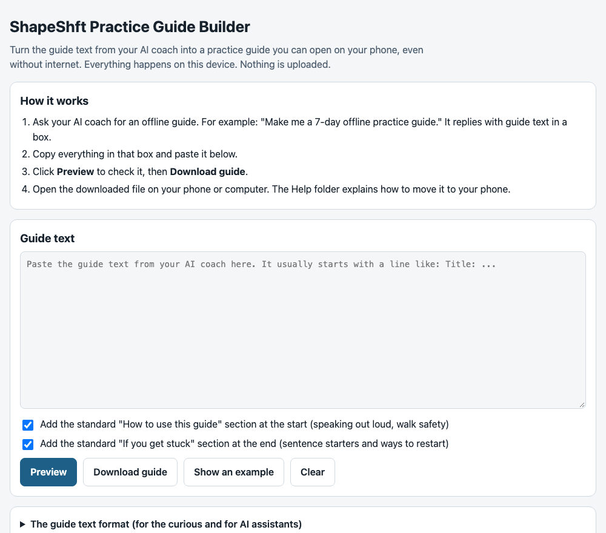

# Offline practice guides

An offline practice guide is a web page file with your personal practice sessions in it. You open it on your phone or computer, even without internet, and practice talking out loud wherever you like, for example on a walk.

## Making a guide

1. Ask your AI coach for a guide. Starter Prompt 10 asks for a 7-day guide. You can also ask for a single session, an interview guide, or a complete conversation reference.
2. The coach replies with guide text in a box. It starts with a line like `Title: ...`. Copy all of it.
3. Open `2-Tools/ShapeShft-Practice-Guide-Builder.html` in your web browser.
4. Paste the text into the big box. Click **Preview**.
5. If it looks right, click **Download guide**. The file goes to your Downloads folder. Its name starts with `ShapeShft-` and ends with `.html`.

The builder checks every guide before it saves it. The guide contains no code, no links to websites and nothing that loads from the internet.

If you only have a phone: the builder page works in a phone's web browser, but opening a local file in a phone browser can be difficult. If it is too hard, ask your AI coach to create the guide file for you directly ("Please create the guide as an HTML file I can download"). Assistants that can create files will follow ShapeShft's safety rules for guides.

## Opening a guide on your phone

You need to move the file to your phone first, then open it.

**Moving the file to your phone (choose one):**

- Email it to yourself, then open the attachment on your phone.
- Save it in a cloud storage service you already use (iCloud Drive, Google Drive, OneDrive, Dropbox), then open it from that app on your phone.
- Use AirDrop (iPhone and Mac) or Nearby Share or Quick Share (Android).

**Opening it:**

- **iPhone or iPad:** tap the file in the Files app or the attachment in Mail. It usually opens in a preview. If the preview looks wrong or the contents list does not work, tap the share button and choose to open it in Safari or another browser, if that option appears.
- **Android:** tap the file in the Files app or in your Downloads. Choose Chrome or another browser if your phone asks which app to use.
- **Windows or Mac:** double-click the file. It opens in your web browser.

What we know and what is not yet confirmed: guides are built only from basic web page features that browsers have supported for many years. They have been checked in Chrome on a Mac. They have not yet been tested on every phone and file preview app. Some preview apps may not open the tap-to-open sections or may show plain styling. All the important text is still readable. If you have a problem, please report it (see "Reporting a problem" in [Troubleshooting](troubleshooting.md)).

## Using a guide on a walk

- Keep the guide open on your phone and look at it as often as you need. You do not need to remember anything.
- **Stop somewhere safe before you read your phone.** Do not read while crossing streets or walking on uneven ground.
- Choose an easy, familiar route where you feel comfortable talking to yourself. A quiet street or an easy path is enough. This is not exercise.
- Practicing at home, sitting or standing, works just as well.

## Printing a guide

Open the guide in your browser and use Print. The contents list and links are hidden in print. Sections that open when tapped may not print unless you open them first.

## Keep your guides private

A guide contains information about your career and the jobs you are applying for. Do not share it publicly. Delete old guides you no longer need. A guide is a snapshot: when you remember something new, tell your AI coach, so it goes into your Career Profile, and ask for a new guide later.
