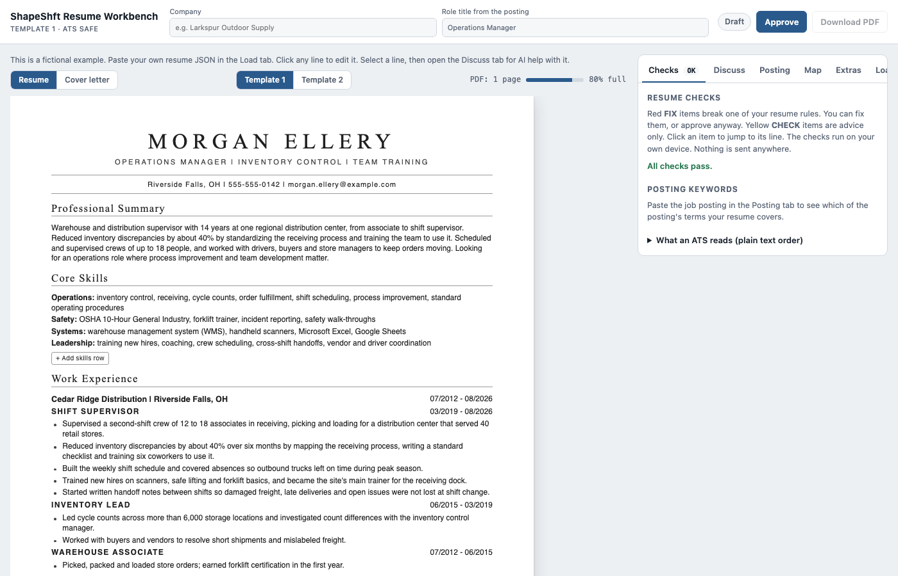

# Using the Resume Workbench

The Resume Workbench is where you review, edit and download your resume and cover letter. It is one file: `2-Tools/ShapeShft-Resume-Workbench.html`. Open it in a web browser (Chrome, Edge, Firefox or Safari). It works without internet and sends nothing anywhere.

A computer or tablet works best. The Workbench works on a phone too, but the page is small.

## 1. Load your application

1. Your AI assistant gives you a block of JSON (text that starts with `{`). Click the copy button on the box, or select all the text in the box and copy it.
2. In the Workbench, click the **Load** tab on the right.
3. Paste into the box and click **Load resume**.

The first time you open the Workbench, it shows a fictional example resume (Morgan Ellery). Loading your own JSON replaces it.

If the Workbench says it could not load the JSON, see [Troubleshooting](troubleshooting.md#the-workbench-will-not-load-my-application).

## 2. Read the checks

The **Checks** tab lists problems the Workbench found, without using AI:

- **FIX** (red): something breaks a resume rule, such as a tool from your "do not claim" list, a placeholder like `[Company]`, or a missing email address.
- **CHECK** (yellow): advice, such as a bullet that is too long, the same first verb used three times, or a number that is not in your confirmed list. Click **Ignore** if it is fine.

Click an item to jump to its line. The tab also shows which words from the job posting your resume uses, and the plain text an applicant tracking system (ATS) would read.

These checks are guidance. They are not an employer's ATS, and they cannot predict an interview.

## 3. Edit

- Click any line on the sheet and type.
- Hover over a bullet, skill row or role to see buttons to move it up, move it down or delete it (the arrows and the x).
- Use **+ Add bullet**, **+ Add skills row** and similar buttons to add lines.
- Switch between **Template 1** and **Template 2** at the top. Both are designed to be read correctly by ATS software.
- The meter shows how full the page is.

If you change a fact, tell your AI assistant too, so your Career Profile stays correct.

## 4. The cover letter

Click **Cover letter** above the sheet. Edit it the same way. If your JSON had no letter, you can start a blank one.

## 5. Ask the AI about a line (Discuss tab)

Click a line on the sheet, then open the **Discuss** tab. When you use the Workbench from your own computer, the buttons there give you a request to copy into your AI assistant. Paste the answer's wording into the sheet yourself if you like it.

## 6. Approve and download

1. Click **Approve**. If there are FIX items, the Checks tab shows them. Fix them, or click **Approve anyway**.
2. Approving locks the lines. Click **Reopen for edits** to change them again.
3. Click **Download PDF** (or **Download** to choose resume, letter, or both). The files go to your Downloads folder.

The PDF has real, selectable text, so ATS software can read it.

## 7. Keep your edits

- **Load tab > Copy JSON:** copies your edited version. Paste it into your AI chat when you want changes that keep your edits (Starter Prompt 5).
- **Load tab > Save as a .json file:** saves this application on your device. You can open it again later with **Open a .json file**.

## Extras tab

Optional additions to the end of the resume, all off by default: a References section, a letter of recommendation PDF added as the last pages, and a salary range line. Use them only when an application asks for them.

## Where the Workbench keeps your work

The Workbench remembers your current resume in your browser's storage on this device (called local storage). This means:

- It is still there when you open the file again in the same browser, on the same device.
- It is **not** on your other devices, and not in other browsers.
- Clearing your browser data, or using a private window, removes it.
- Anyone who uses the same browser profile on this device can see it.

To keep an application safely, use **Save as a .json file**. To remove the stored copy, clear this site's data in your browser settings, or load the example again with **Load > Show the example resume**.

## Limits

- Text is converted to plain ASCII characters for ATS safety. Accented letters lose their accents (for example "José" becomes "Jose").
- Page size is US Letter.
- The Workbench prints the sections it knows: summary, skills, work experience, education, certifications, and the extras. Ask your AI assistant to place other experience (for example volunteer work) as a role in Work Experience.
